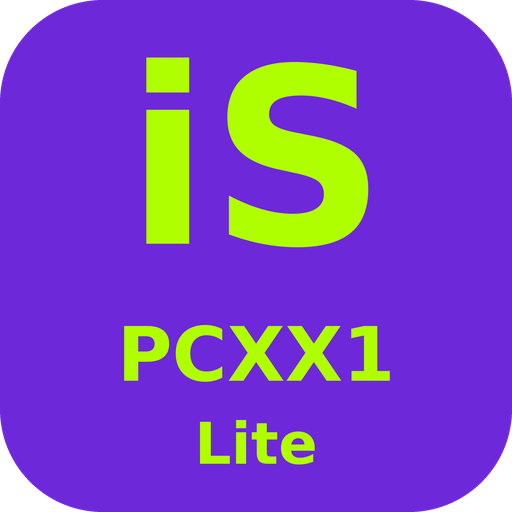
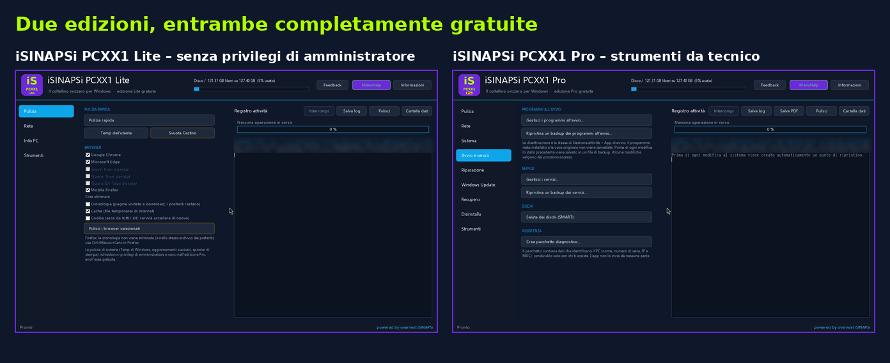
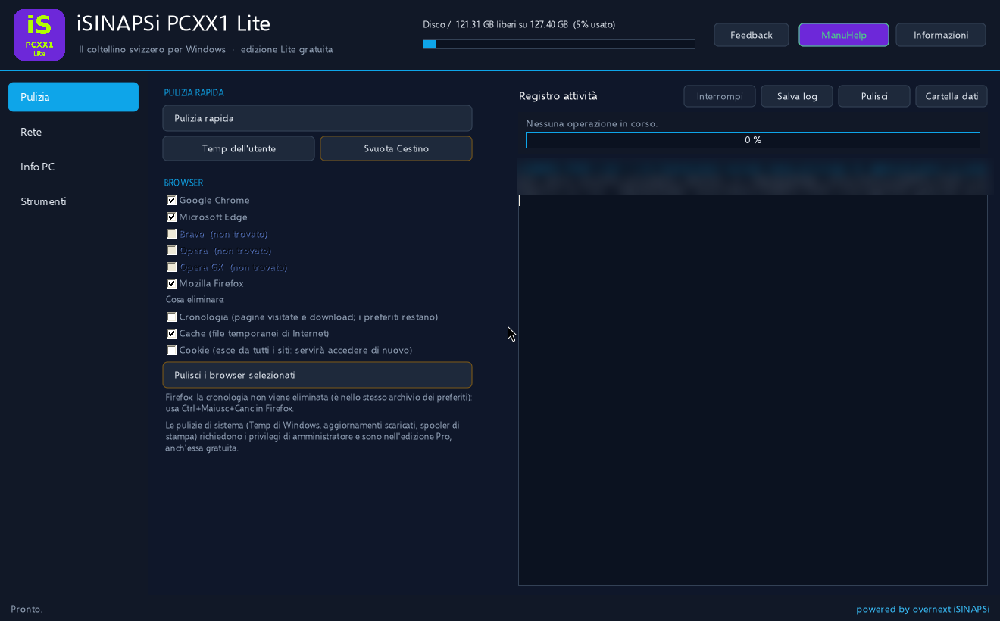
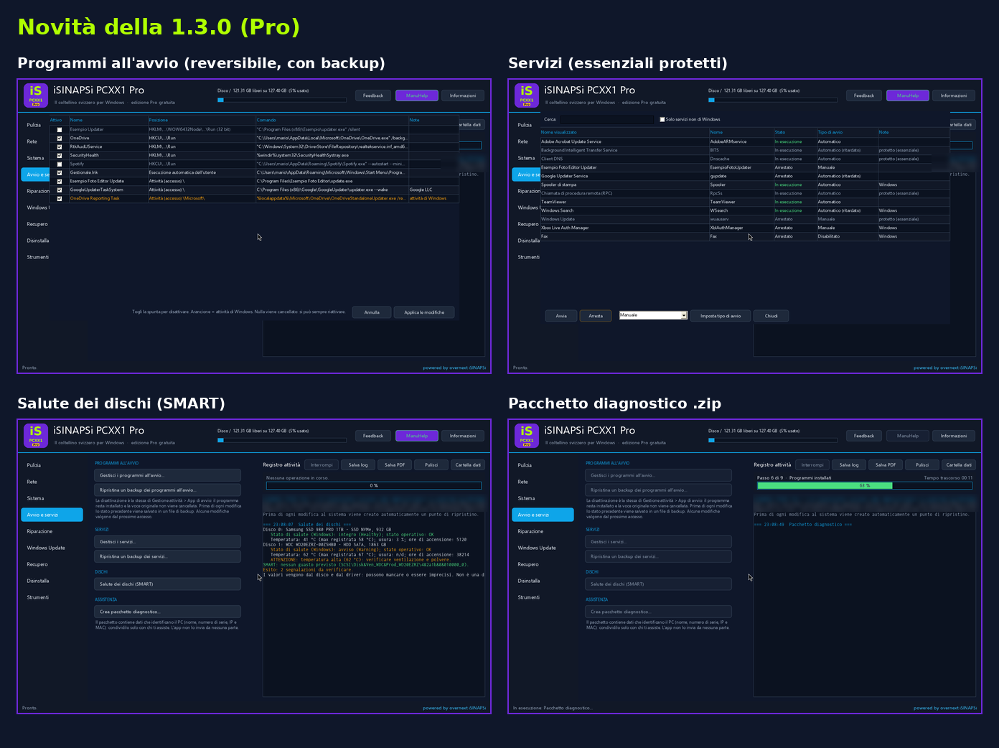
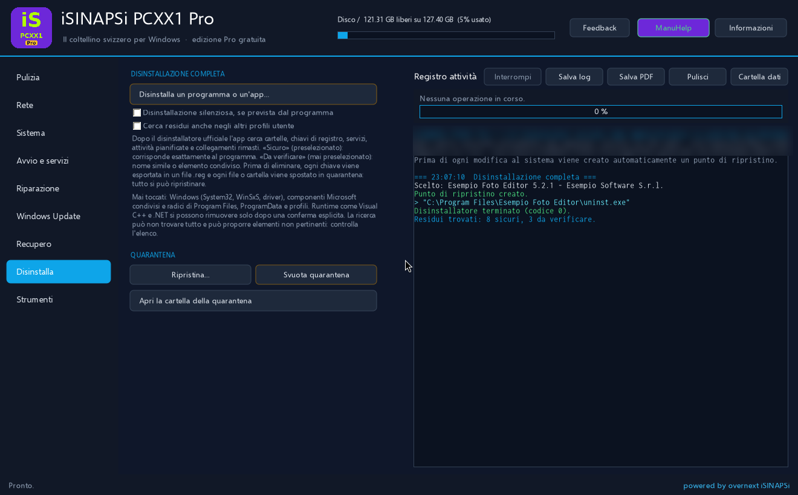
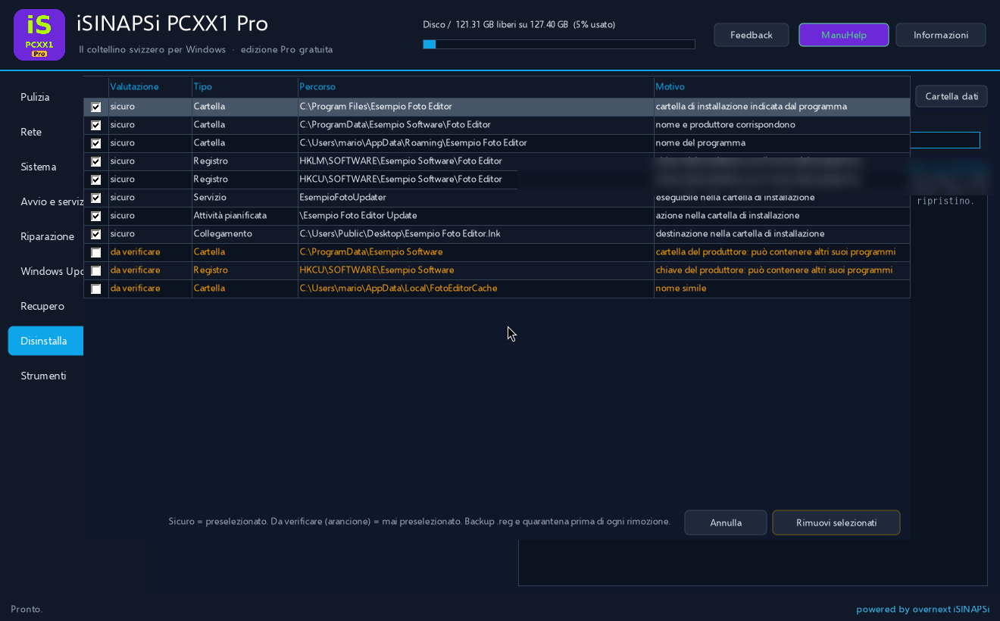
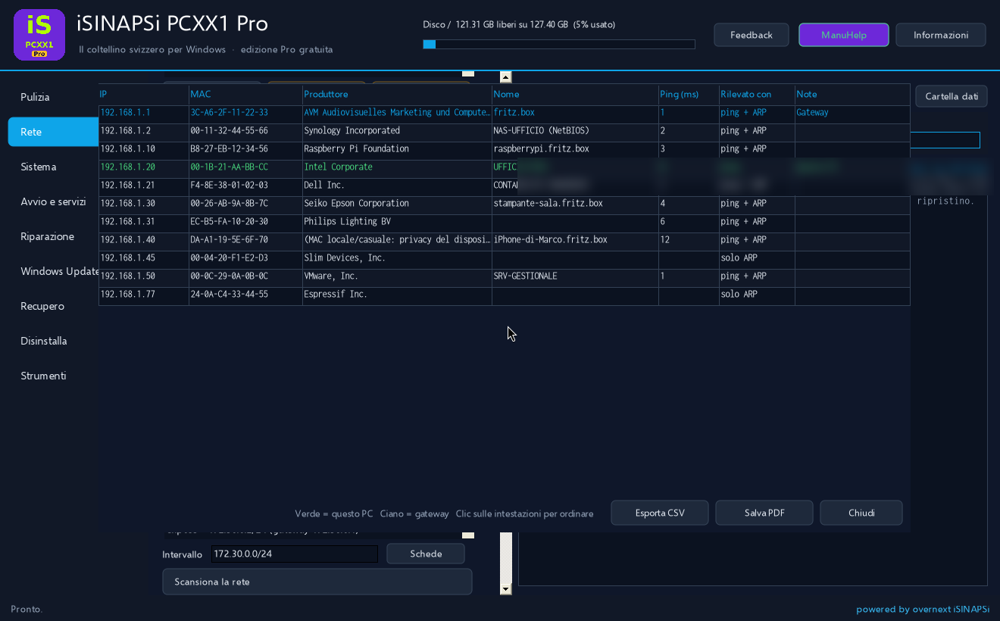
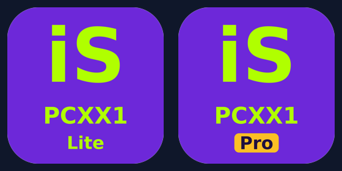

<p align="center">
  
  &nbsp;&nbsp;
  
</p>

<h1 align="center">iSINAPSi™ PCXX1™</h1>
<p align="center"><b>Il coltellino svizzero per Windows</b> · nato dal lavoro quotidiano di un sistemista<br>
Due edizioni, <b>Lite</b> e <b>Pro</b> · <b>completamente gratuite</b><br>
<sub>powered by overnext iSINAPSi</sub></p>

<p align="center">
  <a href="https://github.com/maloxplay/iSINAPSi-PCXX1/releases"></a>
  
  
  
  
</p>

<p align="center"></p>

> ## 💚 Completamente gratuito
> **Nessun costo, nessun abbonamento, nessuna pubblicità, nessuna raccolta di dati.**
> Niente chiavi di licenza, niente attivazioni, niente account. "Lite" e "Pro" indicano solo quante funzioni ci sono: **sono gratuite tutte e due**, anche per uso professionale.

## Da dove nasce
iSINAPSi PCXX1 raccoglie gli strumenti che uso ogni giorno in **tanti anni di attività da sistemista**: le operazioni che ripeto sui PC dei miei clienti, i controlli che faccio prima di metterci le mani e le cose che i clienti stessi mi hanno chiesto di poter fare da soli, in modo semplice e sicuro.
Il risultato è un'unica finestra in italiano, leggera, che mostra sempre cosa sta facendo e chiede conferma prima di ogni operazione che modifica il sistema.

- **Leggero**: exe portable di circa 255 KB (Lite) e 880 KB (Pro).
- **Portable** o installer classico, per entrambe le edizioni.
- **Prudente**: conferma per ogni operazione distruttiva, registro attività su file; nella Pro punto di ripristino automatico, backup prima delle modifiche e quarantena ripristinabile.
- **Trasparente**: solo comandi e funzioni documentati di Windows, mostrati in tempo reale.
- **Riservato**: nessuna telemetria; l'app non invia dati a nessuno (vedi [Privacy](#privacy)).

## Lite o Pro?
| | **Lite** | **Pro** |
|---|:---:|:---:|
| Prezzo | **gratis** | **gratis** |
| Privilegi di amministratore all'uso | non servono | servono (UAC) |
| Pulizia rapida (Temp dell'utente, Cestino, cache dei browser) con spazio prima/dopo | ✅ | ✅ |
| Pulizia browser (Chrome, Edge, Brave, Opera, Opera GX, Firefox): cronologia, cache, cookie | ✅ | ✅ |
| Stato della rete, ping, speed test (Cloudflare) | ✅ | ✅ |
| Informazioni sul PC (report .txt) | ✅ | ✅ |
| Riga di comando per tecnici (`--pulizia-rapida`, `--report`) | ✅ | ✅ |
| Pulizia di sistema (Temp di Windows, cache di Windows Update, spooler, Pulizia disco) | – | ✅ |
| Configurazione di rete, reset dello stack, Wi-Fi, **scanner di rete** IP/MAC, report PDF | – | ✅ |
| **Programmi all'avvio**: disattiva e riattiva (chiavi Run, cartelle Esecuzione automatica, attività all'accesso) | – | ✅ *nuovo* |
| **Servizi**: avvio, arresto, tipo di avvio, con servizi essenziali protetti e backup | – | ✅ *nuovo* |
| **Salute dei dischi (SMART)**: stato, temperatura, usura, errori, previsione di guasto | – | ✅ *nuovo* |
| **Pacchetto diagnostico** .zip per l'assistenza | – | ✅ *nuovo* |
| Riga di comando: `--smart`, `--diagnostica`, `--elenco-avvio` | – | ✅ *nuovo* |
| SFC, DISM, chkdsk, punto di ripristino | – | ✅ |
| Blocco e ripristino di Windows Update | – | ✅ |
| Recupero file (Windows File Recovery e controlli rapidi) | – | ✅ |
| **Disinstallazione completa** con ricerca dei residui, backup `.reg` e quarantena | – | ✅ |
| Editor del file hosts, scorciatoie di sistema | – | ✅ |

Le due edizioni si possono installare **insieme** sullo stesso PC: cartelle, collegamenti e voci in "App installate" sono separati.

## Download
Dalla pagina [Releases](https://github.com/maloxplay/iSINAPSi-PCXX1/releases):

| File | Edizione | Per chi |
|---|---|---|
| `iSINAPSi-PCXX1-Lite-Setup-1.3.0.exe` | Lite | Installazione con collegamenti nel menu Start e sul Desktop (l'installazione chiede i privilegi di amministratore, l'app no). |
| `iSINAPSi-PCXX1-Lite-Portable-1.3.0.exe` | Lite | Un solo file, nessuna installazione. |
| `iSINAPSi-PCXX1-Lite-Portable-1.3.0.zip` | Lite | L'exe portable con licenza ed elenco dei sistemi supportati. |
| `iSINAPSi-PCXX1-Pro-Setup-1.3.0.exe` | Pro | Installazione classica. |
| `iSINAPSi-PCXX1-Pro-Portable-1.3.0.exe` | Pro | Un solo file, nessuna installazione. |
| `iSINAPSi-PCXX1-Pro-Portable-1.3.0.zip` | Pro | L'exe portable con licenza ed elenco dei sistemi supportati. |
| `SHA256SUMS-1.3.0.txt` | – | Impronte SHA-256 di tutti i file. |

Verifica: `Get-FileHash .\nomefile -Algorithm SHA256` in PowerShell e confronta con `SHA256SUMS-1.3.0.txt`.

**I file non sono firmati digitalmente.** La firma del codice potrà essere aggiunta in futuro, in base all'interesse e ai download. Scarica i file solo da questa pagina e controlla l'impronta SHA-256.

## Stato del progetto (beta) – note oneste
- È una **beta pubblica**: può contenere errori. Prima di usare le funzioni che modificano il sistema, fai un backup.
- Il programma è compilato e controllato automaticamente a ogni versione (0 errori, 0 avvisi del compilatore); le schermate sono generate dal programma vero con **dati di esempio**.
- Le funzioni nuove della 1.3.0 (programmi all'avvio, servizi, salute dei dischi, pacchetto diagnostico, riga di comando) **non sono ancora state collaudate su un ampio numero di PC reali**: le segnalazioni sono preziose.
- Nessuno strumento può garantire risultati: la disinstallazione completa **non promette di eliminare ogni traccia**, il recupero file non è garantito, i dati SMART dipendono dal disco e non sono una diagnosi certa.
- Gli antivirus possono segnalare per errore strumenti come questo (PowerShell, privilegi di amministratore, servizi, file hosts): controlla l'impronta SHA-256 e, se hai dubbi, apri una segnalazione.

## Requisiti
- Windows 11 (x64); Windows 10 versione 1607 o successiva, x64 e x86.
- .NET Framework 4.8 (già incluso in Windows 11 e in Windows 10 dalla 1903; per le versioni precedenti si scarica da Microsoft).
- La scheda Recupero (Pro) usa Windows File Recovery, che richiede Windows 10 versione 2004 o successiva.
- **Non supportati:** Windows 7, 8, 8.1; Windows su ARM64; su Windows Server il punto di ripristino non funziona.
- Una versione per macOS è prevista in futuro.

## Le funzioni

### Entrambe le edizioni
<p align="center"></p>

- **Pulizia rapida**: Temp dell'utente (file più vecchi di 24 ore), Cestino e cache dei browser chiusi; spazio libero prima e dopo.
- **Pulizia browser**: scegli i browser e cosa eliminare (cronologia, cache, cookie). I browser aperti vengono saltati. In Firefox la cronologia non viene toccata (sta nello stesso archivio dei preferiti).
- **Rete**: stato delle schede, ping, speed test con il servizio pubblico speed.cloudflare.com.
- **Info PC**: report di sistema in testo.
- **Strumenti**: ManuHelp (apre la pagina ufficiale di RustDesk), Feedback, manutenzione dell'app.

### Novità della Pro 1.3.0
<p align="center"></p>

**Programmi all'avvio** – elenco unico di chiavi Run (`HKCU`, `HKLM` e `WOW6432Node`), cartelle Esecuzione automatica e attività pianificate all'accesso o all'avvio. Togli la spunta per disattivare: per chiavi e cartelle si usa lo stesso meccanismo di Gestione attività > App di avvio (valori `StartupApproved`; la voce originale non viene cancellata), per le attività `schtasks /change /disable`. Prima di ogni modifica lo stato precedente viene salvato in un file di backup, ripristinabile con un clic. Le attività di Windows sono evidenziate e chiedono una conferma in più.
*Nota: il meccanismo `StartupApproved` è quello usato da Windows ma non è documentato ufficialmente da Microsoft.*

**Servizi** – ricerca, stato, tipo di avvio (automatico, ritardato, manuale, disabilitato), avvio e arresto. I servizi essenziali di Windows sono **protetti** (l'app non li arresta e non ne cambia l'avvio); per gli altri servizi di Windows c'è un avviso in più. Prima della prima modifica viene salvato il tipo di avvio di tutti i servizi, ripristinabile.

**Salute dei dischi (SMART)** – `Get-PhysicalDisk`, `Get-StorageReliabilityCounter` e la previsione di guasto SMART (`MSStorageDriver_FailurePredictStatus`): stato di salute, temperatura, usura, errori non corretti, ore di accensione, con avvisi evidenziati. I valori dipendono dal disco: possono mancare.

**Pacchetto diagnostico** – un `.zip` salvato **dove scegli tu** con informazioni di sistema, configurazione di rete, salute dei dischi, errori critici di Windows degli ultimi 7 giorni, programmi all'avvio, servizi, programmi installati e log dell'app. Nessun documento, foto, dato dei browser o posta. Contiene però dati che identificano il PC (nome, numero di serie, IP e MAC): condividilo solo con chi ti assiste. L'app non lo invia da nessuna parte.

**Riga di comando per tecnici**
```
iSINAPSi-PCXX1-Pro.exe --aiuto
iSINAPSi-PCXX1-Pro.exe --pulizia-rapida --si
iSINAPSi-PCXX1-Pro.exe --report C:\Assistenza
iSINAPSi-PCXX1-Pro.exe --smart
iSINAPSi-PCXX1-Pro.exe --diagnostica C:\Assistenza\diagnostica.zip
iSINAPSi-PCXX1-Pro.exe --elenco-avvio
iSINAPSi-PCXX1-Pro.exe --scheda Rete          (apre l'interfaccia su una scheda)
```
Senza `--si` la pulizia rapida mostra solo cosa farebbe. La Pro va lanciata da un prompt come amministratore; per attendere la fine e leggere `%ERRORLEVEL%` usa `start "" /wait ...` (o un file `.bat`). Codici di uscita: 0 ok, 1 errore/avvisi, 2 argomenti non validi, 3 conferma `--si` mancante, 5 servono i privilegi di amministratore. L'uscita viene salvata anche nella cartella Log dell'app. La Lite offre `--pulizia-rapida`, `--report` e `--versione`.

### Le altre funzioni della Pro
<p align="center"></p>

**Disinstalla – disinstallazione completa**: punto di ripristino, disinstallatore ufficiale del programma (o rimozione dell'app dello Store), poi ricerca dei residui (cartelle, chiavi di registro, servizi, attività pianificate, collegamenti) da controllare: «sicuro» è preselezionato, «da verificare» mai. Prima di eliminare, backup `.reg` e **quarantena ripristinabile**. Windows e i componenti condivisi non vengono mai toccati. La ricerca può non trovare tutto e può proporre elementi di altri programmi: l'elenco va sempre controllato.

<p align="center"></p>

**Pulizia** – file temporanei di sistema, cache di Windows Update, spooler di stampa, Pulizia disco di Windows.
**Rete** – configurazione IPv4 e DNS, schede, traceroute, nslookup, test porta TCP, cache DNS e ARP, reset dello stack, profili Wi-Fi. **Scanner di rete**: dispositivi della rete locale con IP, MAC, produttore della scheda e nome; nessuna porta sondata; esportazione CSV e PDF.
> ⚠️ **Usa lo scanner di rete solo su reti tue o su reti per le quali hai l'autorizzazione di chi le gestisce.**

<p align="center"></p>

**Sistema** – report di sistema in .txt e PDF, report batteria, programmi installati. **Riparazione** – punto di ripristino, SFC, DISM, `chkdsk /scan`. **Windows Update** – stato, blocco e ripristino (il blocco ferma anche gli aggiornamenti di sicurezza). **Recupero** – Cestino, Versioni precedenti, Cronologia file e un'interfaccia per Windows File Recovery di Microsoft (installato a parte). **Strumenti** – editor del file hosts con backup, PDF del registro, scorciatoie di sistema.

**Icone:** una grande "iS" verde su viola con sotto il nome dell'edizione; la Pro ha la targhetta oro.
<p align="center"></p>

## Sicurezza: come lavora
- **Conferma esplicita** per ogni operazione distruttiva; ogni conferma o annullamento finisce nel registro.
- **Registro attività su file**: Pro in `%ProgramData%\iSINAPSi-PCXX1-Pro\Log`, Lite in `%LOCALAPPDATA%\iSINAPSi-PCXX1-Lite\Log` (portable: nella cartella `-Dati` accanto all'exe).
- **Pro: punto di ripristino automatico** prima delle modifiche; **backup** prima di cambiare avvio e servizi; **quarantena** della disinstallazione completa accessibile solo ad amministratori e SYSTEM. Non sostituiscono un backup dei dati.
- Usa l'app su PC di altre persone solo con il loro consenso.

## Privacy
Nessuna telemetria, nessun account, nessuna pubblicità, nessun aggiornamento automatico: **l'app non invia dati né a noi né a terzi**. Report, log, backup, pacchetti diagnostici e quarantena restano sul PC. Generano traffico solo gli strumenti che avvii tu: diagnostica di rete, scanner di rete (Pro), speed test (Cloudflare riceve l'IP pubblico), ManuHelp (apre la pagina di RustDesk su GitHub) e l'installazione di Windows File Recovery (Pro). Le segnalazioni partono solo se le invii tu dal browser o dal tuo programma di posta. Report e log contengono dati del PC e della rete: **oscurali prima di allegarli a una segnalazione pubblica**.

## FAQ
**È davvero gratis?** Sì, completamente: entrambe le edizioni, senza costi, pubblicità o raccolta di dati. È software proprietario gratuito (non open source) di iSINAPSi: puoi usarlo anche per lavoro e ridistribuirlo gratis solo nei file originali non modificati, con il link a questa pagina. Condizioni complete in [LICENSE](LICENSE).

**Che differenza c'è tra Lite e Pro?** Solo le funzioni: la Lite fa le cose di tutti i giorni senza privilegi di amministratore; la Pro ha tutti gli strumenti da tecnico e chiede i privilegi di amministratore.

**Avevo una versione precedente (fino alla 1.2.0, con un nome diverso).** L'installer della 1.3.0 la aggiorna: rimuove la vecchia installazione, i suoi collegamenti e la sua voce in "App installate"; al primo avvio l'app sposta i dati nella nuova cartella.

**Il codice sorgente è disponibile?** Non al momento: questo repository distribuisce i programmi e raccoglie feedback e segnalazioni.

**Lo scanner di rete è legale?** Sulla tua rete o su quella di un cliente che ti ha autorizzato, sì: invia solo ping e richieste di nome e non sonda porte. Su reti altrui senza autorizzazione no.

## Feedback
- 🐞 [Segnala un problema](https://github.com/maloxplay/iSINAPSi-PCXX1/issues/new?template=bug_report.yml)
- 💡 [Proponi una funzione](https://github.com/maloxplay/iSINAPSi-PCXX1/issues/new?template=feature_request.yml)
- ✉️ E-mail: [isinapsicloud@gmail.com](mailto:isinapsicloud@gmail.com)
- ⭐ Se ti è utile, lascia una stella: aiuta altri tecnici a trovarlo.

Vulnerabilità di sicurezza: non aprire una issue pubblica, segui [SECURITY.md](SECURITY.md).

## English
**iSINAPSi™ PCXX1™** is a **completely free** Windows toolkit (Italian user interface) born from many years of work as a systems administrator and from clients' requests. Two editions, **both free**, with no fees, no ads and no data collection: **Lite** (no administrator rights needed: quick cleanup, browser cleanup, network status, ping, speed test, PC info report) and **Pro** (administrator rights: system cleanup, network tools and local network scanner – use it only on networks you are authorized to scan –, startup apps manager with reversible disable and backups, services manager with protected critical services, SMART disk health, diagnostic bundle, technician command line, SFC/DISM/chkdsk, Windows Update block/restore, file-recovery helpers and a complete uninstaller with leftover review, .reg backups and a restorable quarantine). Results are never guaranteed and the uninstaller never claims to remove every trace. **Public beta.** Binaries are **not digitally signed**: verify the SHA-256. Requires Windows 10 1607+ or Windows 11 with .NET Framework 4.8. Free proprietary software (not open source); author, copyright holder and licensor: iSINAPSi; idea by overnext.

---
iSINAPSi™ e PCXX1™ sono marchi di iSINAPSi. Windows, Microsoft Edge, Windows File Recovery e Microsoft Store sono marchi o prodotti di Microsoft Corporation. Google Chrome è un marchio di Google LLC; Firefox della Mozilla Foundation; Brave di Brave Software, Inc.; Opera di Opera Norway AS; Cloudflare di Cloudflare, Inc. RustDesk appartiene ai rispettivi titolari. Il produttore delle schede di rete è ricavato dal registro pubblico MA-L della IEEE Registration Authority; IEEE è un marchio di The Institute of Electrical and Electronics Engineers, Inc. iSINAPSi PCXX1 non è affiliato a nessuno di questi soggetti né sponsorizzato o approvato da essi. Gli altri marchi citati appartengono ai rispettivi titolari. Componenti e servizi di terze parti: [THIRD-PARTY-NOTICES.md](THIRD-PARTY-NOTICES.md).

## Crediti
Autore, titolare dei diritti e licenziante: **iSINAPSi** · Ideatore: **overnext**

© 2026 iSINAPSi - ideato da overnext · powered by overnext iSINAPSi
