
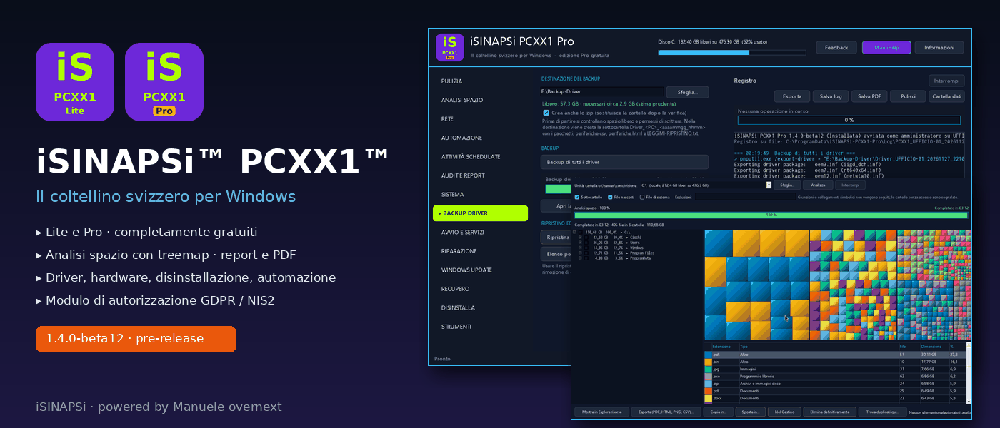

<h1 align="center">iSINAPSi™ PCXX1™</h1>

<b>Il coltellino svizzero per Windows</b> · due edizioni, <b>Lite</b> e <b>Pro</b>, <b>completamente gratuite</b>

  
  
  
  
  

<a href="https://github.com/maloxplay/iSINAPSi-PCXX1/releases/tag/v1.4.0-beta12"><b>⬇ Scarica la 1.4.0-beta12 (pre-release)</b></a>

> ## ⚠ Beta per tecnici: leggi prima di usarla
> **Il programma è fornito gratuitamente «così com'è» (AS IS), senza garanzie di alcun tipo. Lo usi a tuo rischio.**
> È distribuito per **test, feedback e critiche migliorative** ed è riservato a **tecnici qualificati**, solo su computer **propri o per i quali si ha l'autorizzazione** del proprietario.
> Prima di ogni operazione che modifica il sistema fai un **backup completo e verificato**: alcune operazioni non sono reversibili.
> Nei limiti consentiti dalla legge (art. 1229 del codice civile) l'autore non risponde di danni diretti o indiretti, perdita di dati, uso improprio o non autorizzato; la limitazione non vale per dolo o colpa grave.
> Al primo avvio il programma chiede una **doppia accettazione**: la licenza d'uso 3.0 e, separatamente, le clausole ai sensi degli artt. 1341-1342 c.c. Testo completo: [LICENSE](LICENSE).

## Cos'è
Un'unica finestra in italiano con gli strumenti che un sistemista usa ogni giorno: pulizia, analisi dello spazio, rete, stato dell'hardware, report per il cliente e, nella Pro, riparazione, driver, programmi all'avvio, servizi, disinstallazione e automazione.
- **Niente azioni automatiche**: ogni operazione parte solo su clic; quelle distruttive chiedono conferma.
- **Trasparente**: solo comandi e API documentati di Windows; avanzamento con percentuale e tempo; registro su file.
- **Riservato**: nessuna telemetria; l'app non invia dati a nessuno.
- **Export** CSV, HTML e PDF scritti direttamente nel file scelto e mai aperti in automatico: «Apri file» e «Apri cartella» solo su clic.
- **Exe .NET normale**, non compresso, senza autoestrazione. La Lite gira senza privilegi di amministratore.

## Galleria

| | |
|:---:|:---:|
| 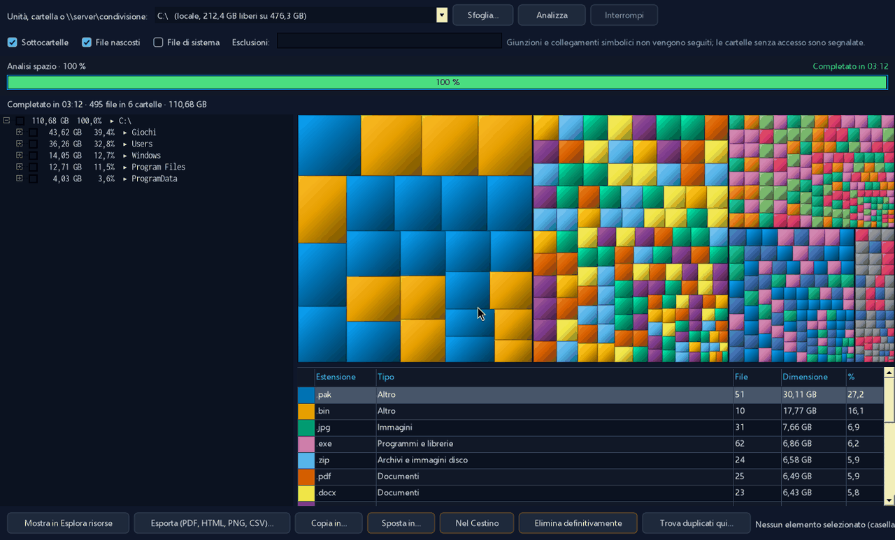 <b>Analisi spazio</b>: treemap colorata per tipo di file, albero per dimensione e statistiche per estensione | 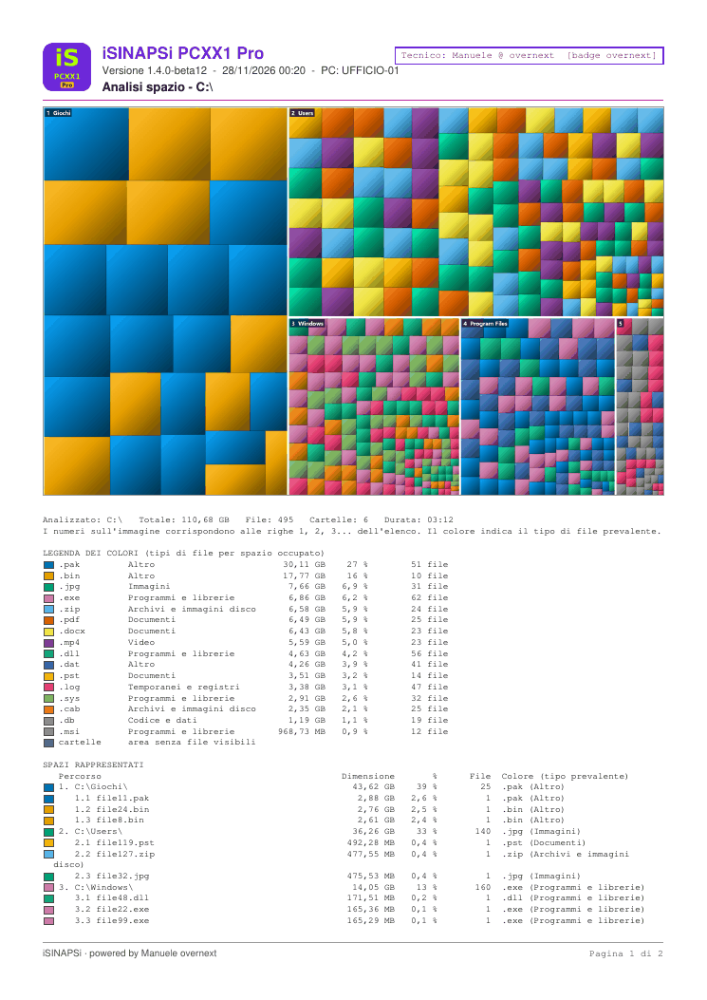 <b>PDF esportato</b>: treemap numerata, legenda dei colori ed elenco degli spazi rappresentati |
| 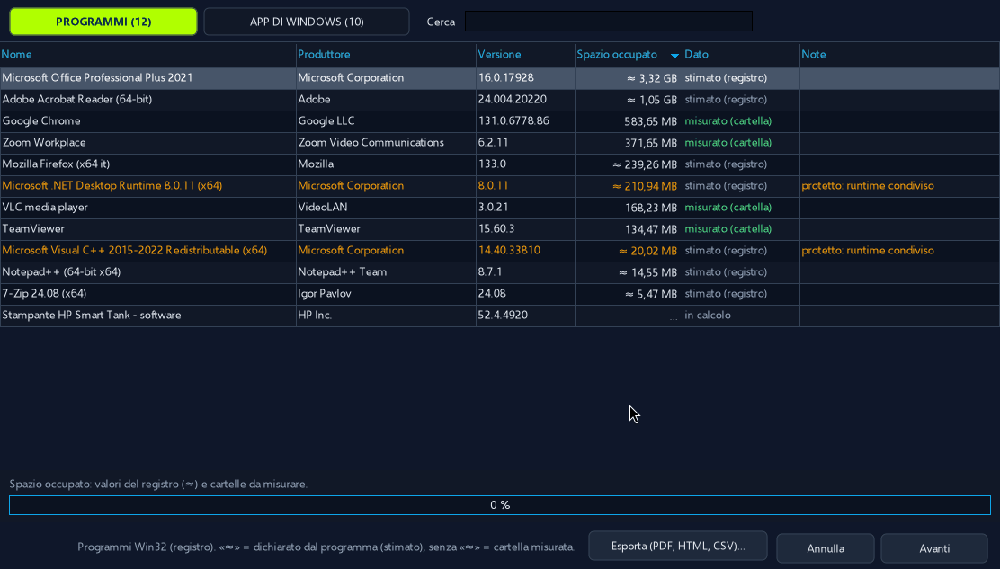 <b>Disinstalla – Programmi</b> (Pro): spazio occupato stimato dal registro o misurato sulla cartella | 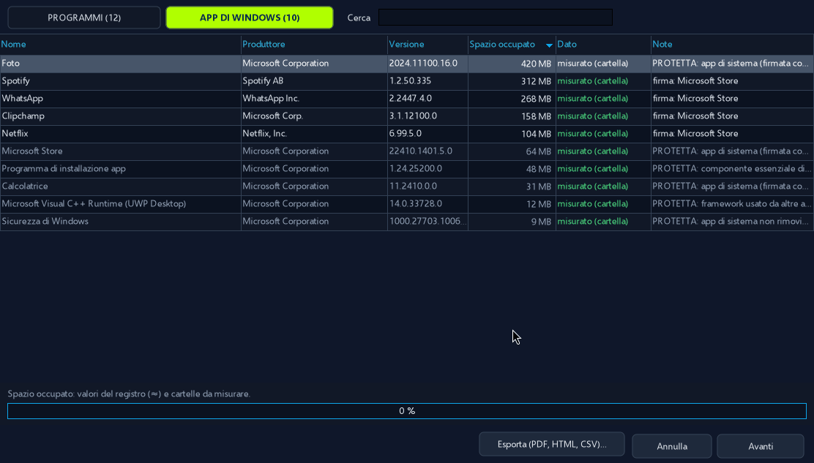 <b>Disinstalla – App di Windows</b> (Pro): app di sistema elencate ma protette |
| 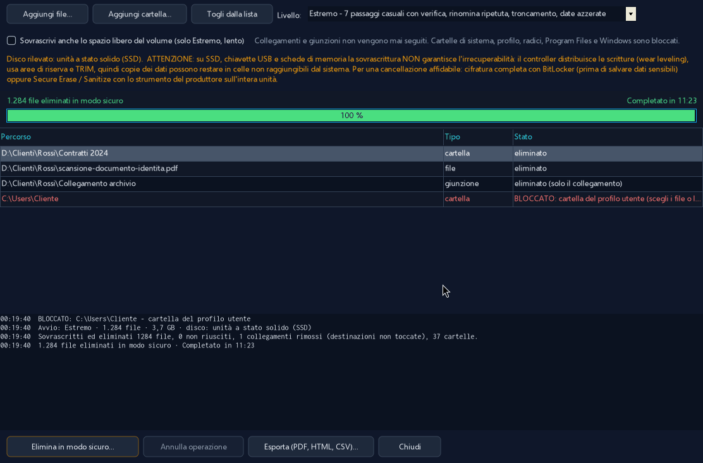 <b>Eliminazione sicura</b> (Pro): livelli da Rapido a Estremo, avviso onesto su SSD e USB, cartelle di sistema bloccate | 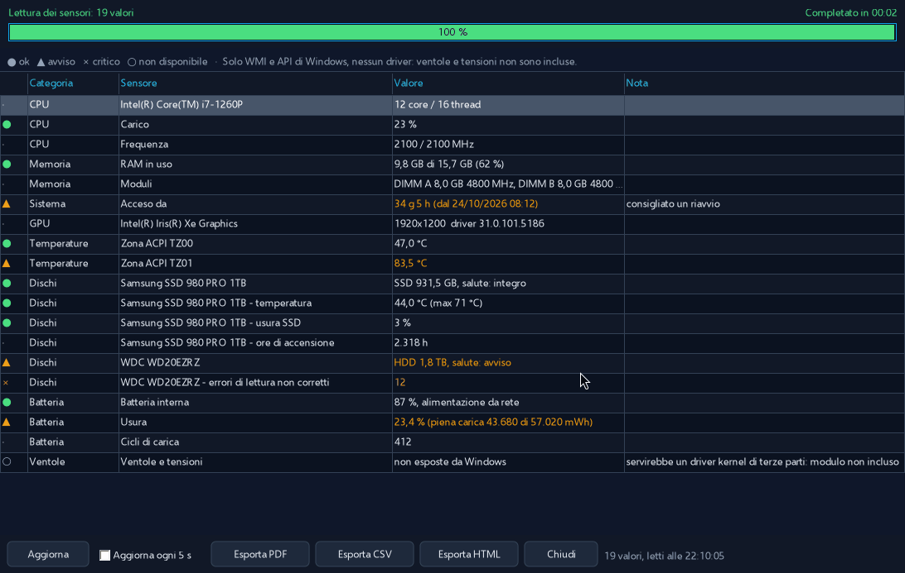 <b>Stato hardware</b>: temperature, SMART dei dischi, batteria, CPU, RAM e GPU senza driver aggiuntivi |
| 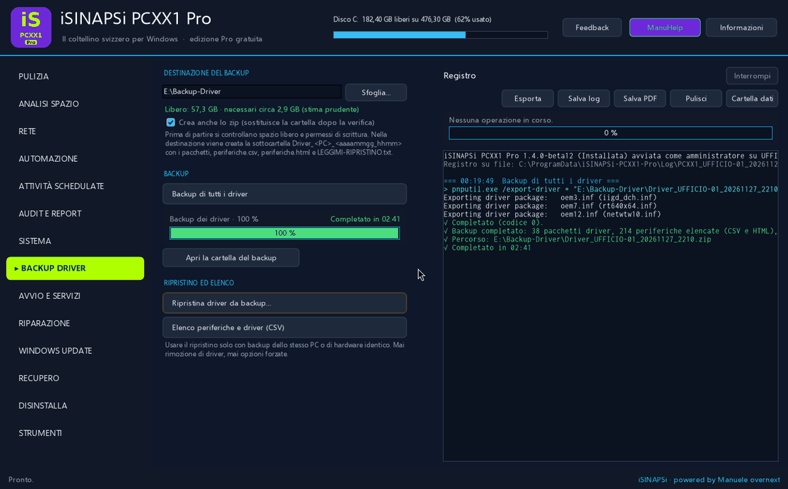 <b>Backup driver</b> (Pro): esportazione con pnputil, elenco periferiche CSV/HTML e zip facoltativo | 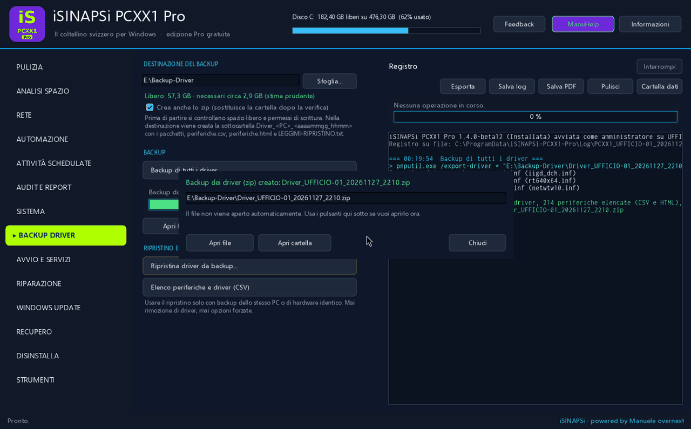 <b>Dopo ogni export</b>: notifica con «Apri file» e «Apri cartella», attivi solo su clic |
| 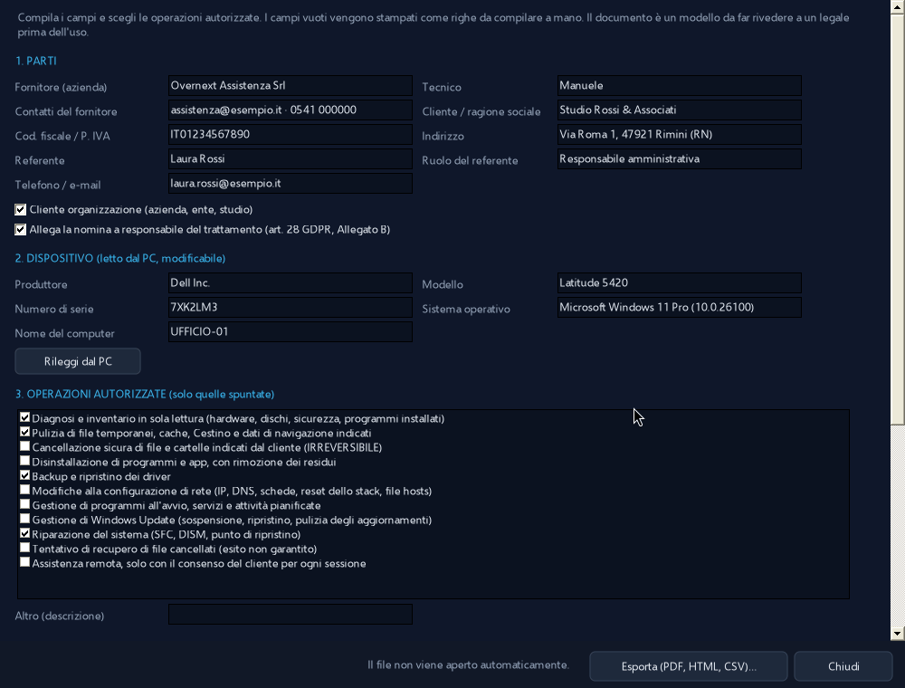 <b>Modulo di autorizzazione</b>: dati del PC letti in sola lettura, operazioni autorizzate, backup o rinuncia |  <b>Modulo in PDF</b> da far firmare al cliente, con allegati facoltativi |
| 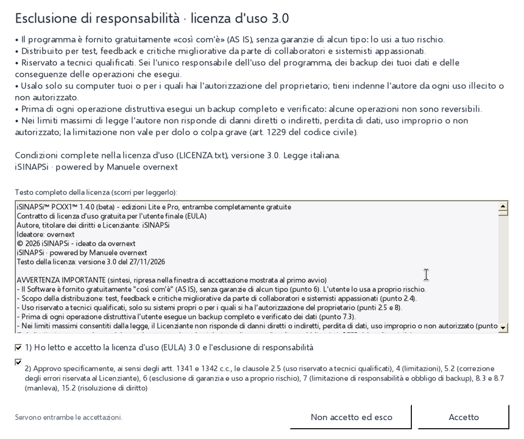 <b>Primo avvio</b>: testo completo della licenza e doppia accettazione (artt. 1341-1342 c.c.) | 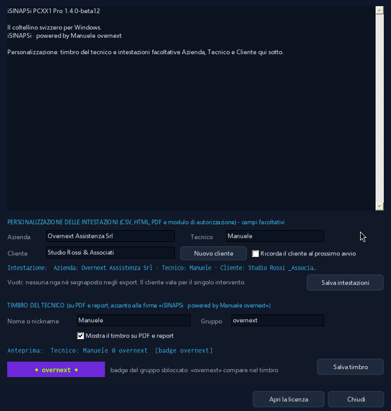 <b>Personalizzazione</b>: Azienda, Tecnico e Cliente facoltativi nelle intestazioni, timbro del tecnico |
| 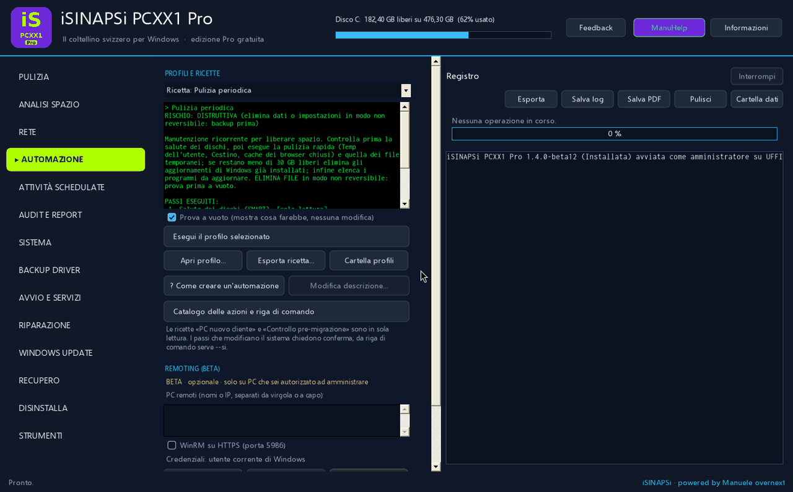 <b>Automazione</b> (Pro): descrizione, livello di rischio e passi di ogni ricetta | 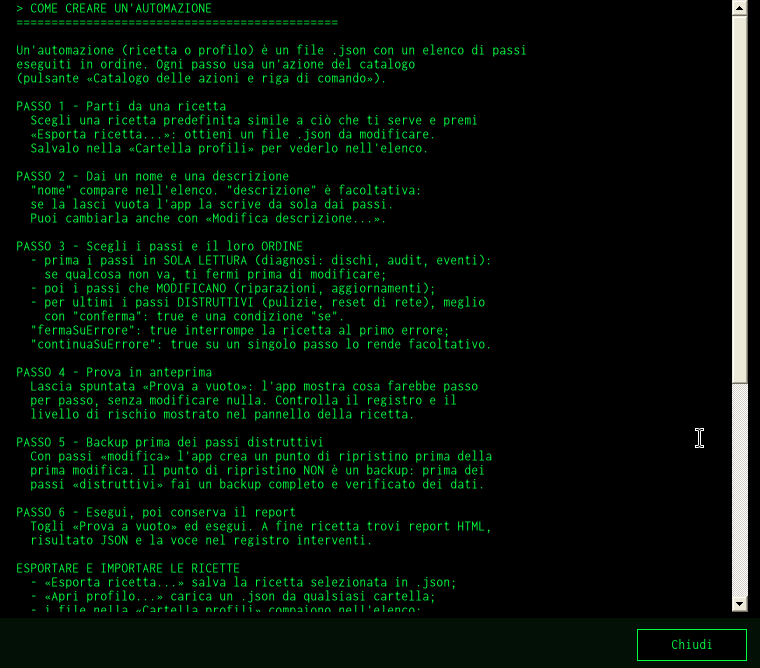 <b>Guida integrata</b> «Come creare un'automazione», in stile Matrix |

## Le funzioni

### Analisi spazio: la verifica grafica dello spazio (Lite e Pro)
Dischi locali, unità di rete, percorsi UNC e cartelle, con sottocartelle, file nascosti e di sistema ed esclusioni. Giunzioni e collegamenti non vengono seguiti; gli accessi negati sono segnalati. La **treemap** mostra a colpo d'occhio cosa occupa spazio, colorata per tipo di file, accanto all'albero ordinato per dimensione e alle statistiche per estensione. Si esporta in **PDF** (treemap più elenco numerato), **PNG**, **CSV** e **HTML**. Nella Pro: ricerca dei duplicati e azioni sulla selezione con conferma.

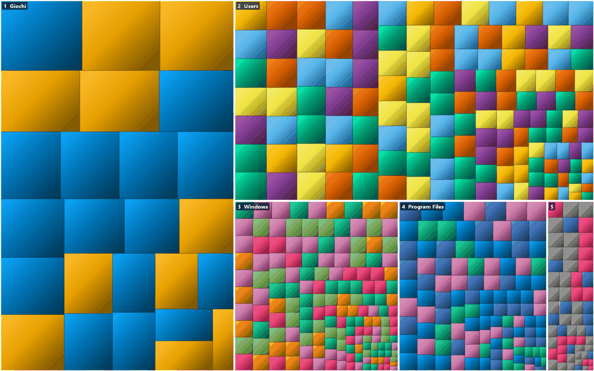 Treemap esportata in PNG: i numeri delle aree corrispondono alle righe dell'elenco nel PDF.

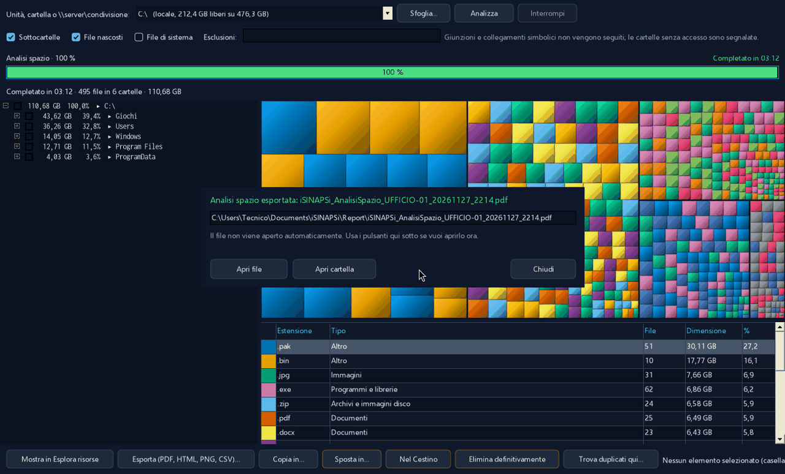

### Disinstallazione e app di Windows (Pro)
Programmi Win32 dal registro e app di Windows (pacchetti Appx/MSIX dell'utente) con la colonna **Spazio occupato** ordinabile. Le app di sistema e i componenti essenziali sono elencati ma protetti. Rimozione solo su clic, con conferma, e ricerca dei residui.

### Eliminazione sicura (Pro)
File e cartelle con quattro livelli (Rapido, Standard NIST SP 800-88 «Clear», Rafforzato, Estremo). Il tipo di disco viene rilevato e su SSD, USB e schede l'app avvisa che la sovrascrittura non garantisce l'irrecuperabilità. Doppia conferma; radici, Windows, Program Files e cartelle del profilo sono bloccati.

### Stato hardware e backup dei driver
Sensori leggibili senza driver kernel (temperature ACPI, SMART e salute dei dischi, batteria, CPU, RAM e GPU), aggiornamento facoltativo ogni 5 secondi ed export PDF, CSV e HTML. Nella Pro, **Backup driver** con controllo di spazio e permessi, elenco delle periferiche e zip con nome del PC e data.

### Report, modulo di autorizzazione e personalizzazione
Report per il cliente in HTML e PDF. Il **modulo di autorizzazione all'intervento** si esporta in PDF, HTML e CSV e contiene: dati del dispositivo, operazioni autorizzate, dichiarazione di backup o rinuncia, responsabilità entro l'art. 1229 c.c., informativa GDPR, allegato facoltativo di nomina a responsabile del trattamento (art. 28) e sezione facoltativa NIS2 (D.Lgs. 138/2024). I campi **Azienda, Tecnico e Cliente** compaiono nelle intestazioni di tutti gli export solo se compilati; «Nuovo cliente» svuota il cliente a ogni intervento.

 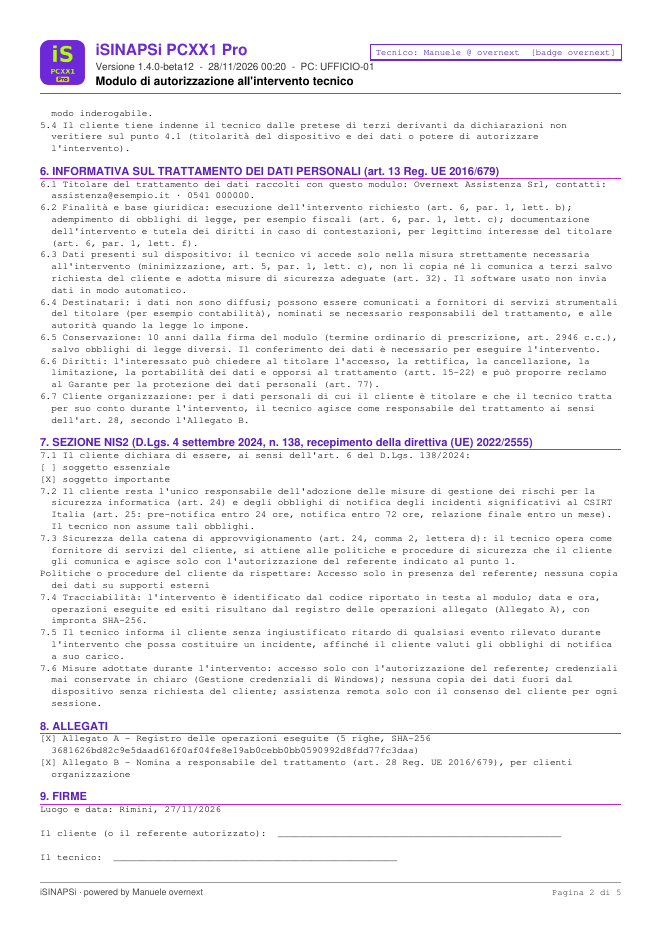

### Automazione (Pro)
Ricette predefinite e personali con descrizione, **livello di rischio** (sola lettura / modifica / distruttiva) e passi eseguiti; prova a vuoto, esportazione e importazione delle ricette e guida integrata passo passo.

Elenco completo delle modifiche: [CHANGELOG](CHANGELOG.md).

## Download
Dalla pagina della [**pre-release 1.4.0-beta12**](https://github.com/maloxplay/iSINAPSi-PCXX1/releases/tag/v1.4.0-beta12):

| File | Edizione | Tipo |
|---|---|---|
| `iSINAPSi-PCXX1-Lite-Portable-1.4.0-beta12.zip` | Lite | portable (zip, distribuzione principale) |
| `iSINAPSi-PCXX1-Lite-Setup-1.4.0-beta12.exe` | Lite | installazione classica |
| `iSINAPSi-PCXX1-Pro-Portable-1.4.0-beta12.zip` | Pro | portable (zip, distribuzione principale) |
| `iSINAPSi-PCXX1-Pro-Setup-1.4.0-beta12.exe` | Pro | installazione classica |

I file **non sono firmati digitalmente**: verifica le impronte con [SHA256SUMS-1.4.0-beta12.txt](SHA256SUMS-1.4.0-beta12.txt). In PowerShell: `Get-FileHash .\nomefile -Algorithm SHA256`.

## Requisiti
Windows 11 x64 o Windows 10 1607 o successivo, con .NET Framework 4.8. La Pro chiede i privilegi di amministratore (UAC); la Lite no.

## Feedback e sicurezza
Segnalazioni e proposte: scheda *Issues* (modelli «Bug» e «Proposta»). Vulnerabilità: **non** aprire una issue pubblica, vedi [SECURITY](SECURITY.md).

## Licenza e marchi
Software gratuito distribuito con la licenza d'uso in [LICENSE](LICENSE) (EULA 3.0, legge italiana). Il codice sorgente non è distribuito in questo repository. iSINAPSi™ e PCXX1™ sono segni distintivi dell'autore; i nomi di terzi citati in [THIRD-PARTY-NOTICES](THIRD-PARTY-NOTICES.md) appartengono ai rispettivi titolari. Le schermate usano dati e percorsi di esempio.

iSINAPSi · powered by Manuele overnext

