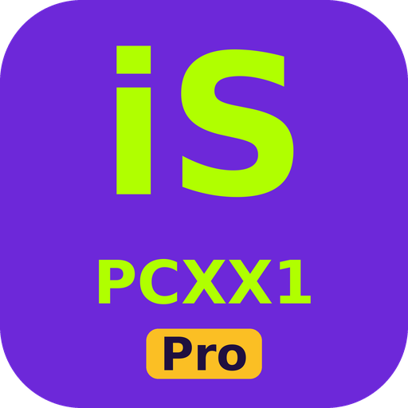
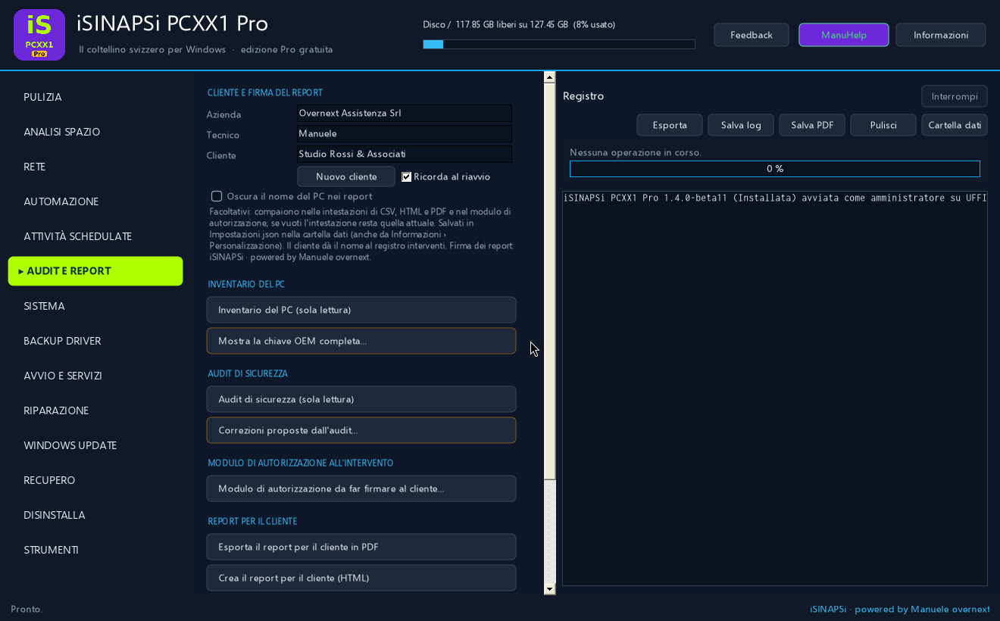
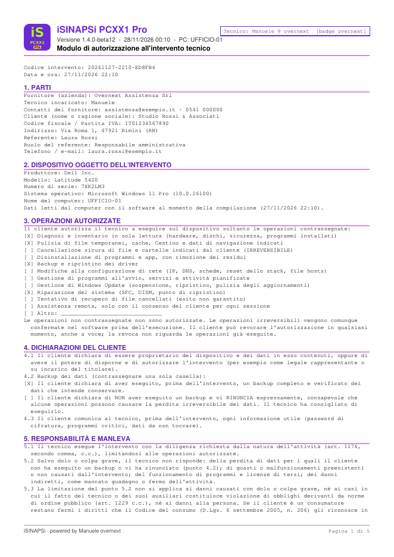

  
  &nbsp;&nbsp;
  

<h1 align="center">iSINAPSi™ PCXX1™ 1.4.0-beta12</h1>

<b>Il coltellino svizzero per Windows</b> · due edizioni, <b>Lite</b> e <b>Pro</b>, <b>completamente gratuite</b> 
iSINAPSi · powered by Manuele overnext

> ## ⚠ Beta per tecnici: leggi prima di usarla
> **Il programma è fornito gratuitamente «così com'è» (AS IS), senza garanzie di alcun tipo. Lo usi a tuo rischio.**
> È distribuito per **test, feedback e critiche migliorative**. È riservato a **tecnici qualificati**, solo su computer **propri o per i quali si ha l'autorizzazione** del proprietario.
> Prima di ogni operazione che modifica il sistema fai un **backup completo e verificato**: alcune operazioni non sono reversibili.
> Nei limiti consentiti dalla legge (art. 1229 del codice civile) l'autore non risponde di danni diretti o indiretti, perdita di dati, uso improprio o non autorizzato; la limitazione non vale per dolo o colpa grave.
> Al primo avvio il programma chiede una **doppia accettazione**: la licenza d'uso 3.0 e, separatamente, le clausole ai sensi degli artt. 1341-1342 c.c. Testo completo: [LICENSE](LICENSE).

## Cos'è
Un'unica finestra in italiano con gli strumenti che un sistemista usa ogni giorno: pulizia, analisi dello spazio, rete, informazioni e stato dell'hardware, report per il cliente e, nella Pro, riparazione, driver, programmi all'avvio, servizi, disinstallazione e automazione.
- **Niente azioni automatiche**: ogni operazione parte solo su clic; quelle distruttive chiedono conferma.
- **Trasparente**: solo comandi e API documentati di Windows; avanzamento con percentuale e tempo; registro su file.
- **Riservato**: nessuna telemetria; l'app non invia dati a nessuno.
- **Export** CSV, HTML e PDF scritti direttamente nel file scelto; mai aperti in automatico («Apri file» / «Apri cartella» solo su clic).
- **Exe .NET normale**, non compresso, senza autoestrazione. La Lite gira senza privilegi di amministratore.

## Novità della 1.4.0 (beta11 e beta12)
- **Modulo di autorizzazione all'intervento** da far firmare al cliente (Lite e Pro): PDF, HTML stampabile e CSV con i dati letti dal PC (produttore, modello, numero di serie, sistema operativo, data e ora), operazioni autorizzate, dichiarazione di backup o rinuncia espressa, responsabilità e manleva entro l'art. 1229 c.c., informativa GDPR (art. 13), allegato facoltativo di nomina a responsabile del trattamento (art. 28) e sezione facoltativa NIS2 (D.Lgs. 138/2024), registro della sessione allegato con impronta SHA-256, firme.
- **Personalizzazione**: campi facoltativi Azienda, Tecnico e Cliente nelle intestazioni di tutti gli export; pulsante «Nuovo cliente». Se vuoti, nessuna riga in più.
- **Licenza 3.0** con doppia accettazione al primo avvio; nella beta12 il testo, verificato da un professionista, non contiene più note di revisione.
- **Automazione** (Pro): ogni ricetta mostra descrizione, livello di rischio (sola lettura / modifica / distruttiva) e passi eseguiti; guida integrata «Come creare un'automazione».

 

Elenco completo delle modifiche: [CHANGELOG](CHANGELOG.md).

## Download
Dalla pagina **Releases** (pre-release 1.4.0-beta12):

| File | Edizione | Tipo |
|---|---|---|
| `iSINAPSi-PCXX1-Lite-Portable-1.4.0-beta12.zip` | Lite | portable (zip, distribuzione principale) |
| `iSINAPSi-PCXX1-Lite-Setup-1.4.0-beta12.exe` | Lite | installazione classica |
| `iSINAPSi-PCXX1-Pro-Portable-1.4.0-beta12.zip` | Pro | portable (zip, distribuzione principale) |
| `iSINAPSi-PCXX1-Pro-Setup-1.4.0-beta12.exe` | Pro | installazione classica |

I file **non sono firmati digitalmente**: verifica le impronte con [SHA256SUMS-1.4.0-beta12.txt](SHA256SUMS-1.4.0-beta12.txt). In PowerShell: `Get-FileHash .\nomefile -Algorithm SHA256`.

## Requisiti
Windows 11 x64 o Windows 10 1607 o successivo, con .NET Framework 4.8. La Pro chiede i privilegi di amministratore (UAC); la Lite no.

## Feedback e sicurezza
Segnalazioni e proposte: scheda *Issues* (modelli «Bug» e «Proposta»). Vulnerabilità: **non** aprire una issue pubblica, vedi [SECURITY](SECURITY.md).

## Licenza e marchi
Software gratuito distribuito con la licenza d'uso in [LICENSE](LICENSE) (EULA 3.0, legge italiana). Il codice sorgente non è distribuito in questo repository. iSINAPSi™ e PCXX1™ sono segni distintivi dell'autore; i nomi di terzi citati in [THIRD-PARTY-NOTICES](THIRD-PARTY-NOTICES.md) appartengono ai rispettivi titolari.

iSINAPSi · powered by Manuele overnext
